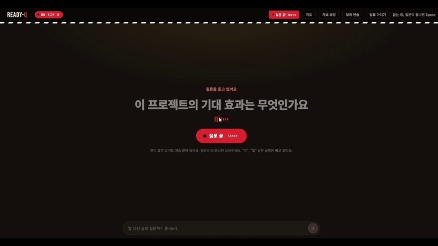
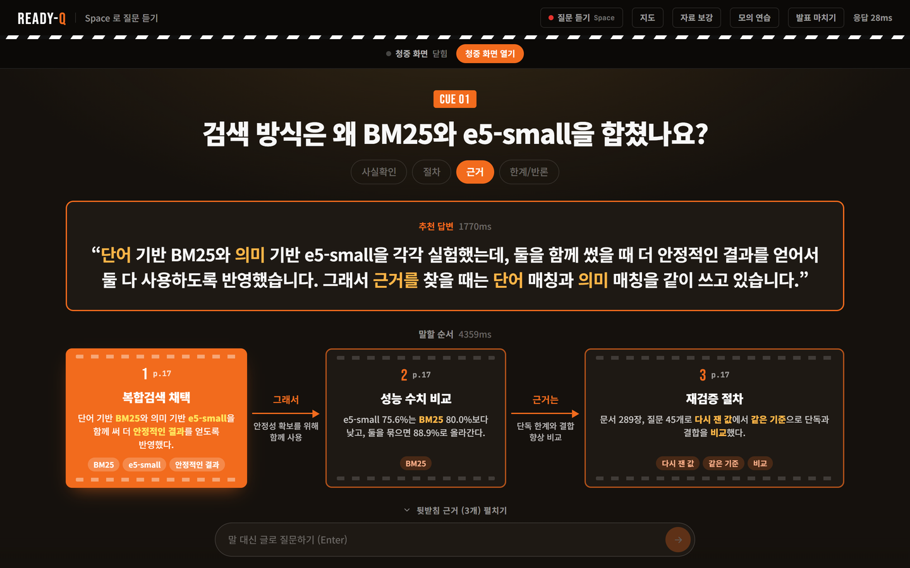
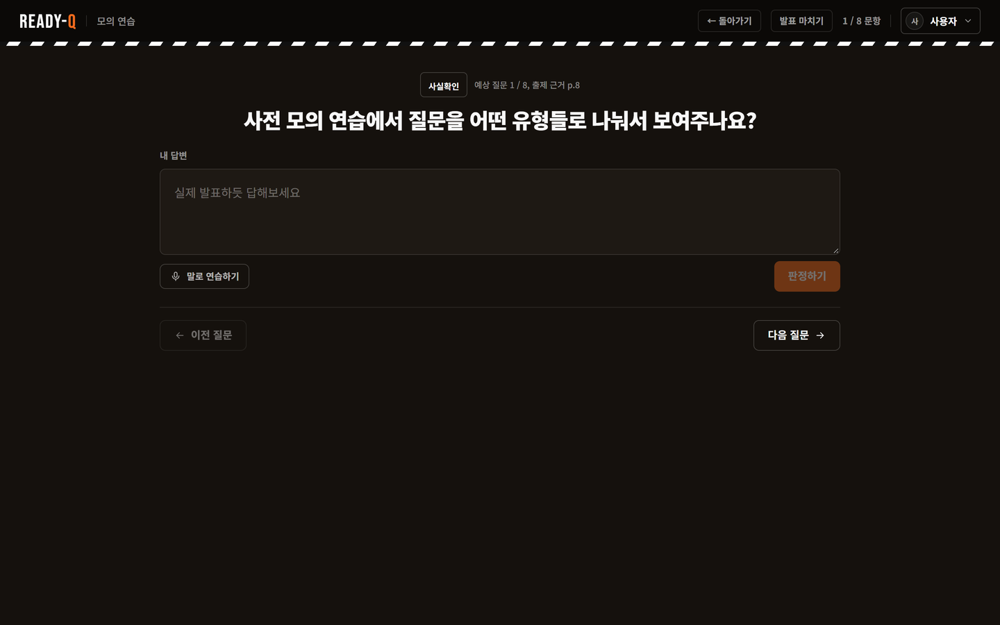
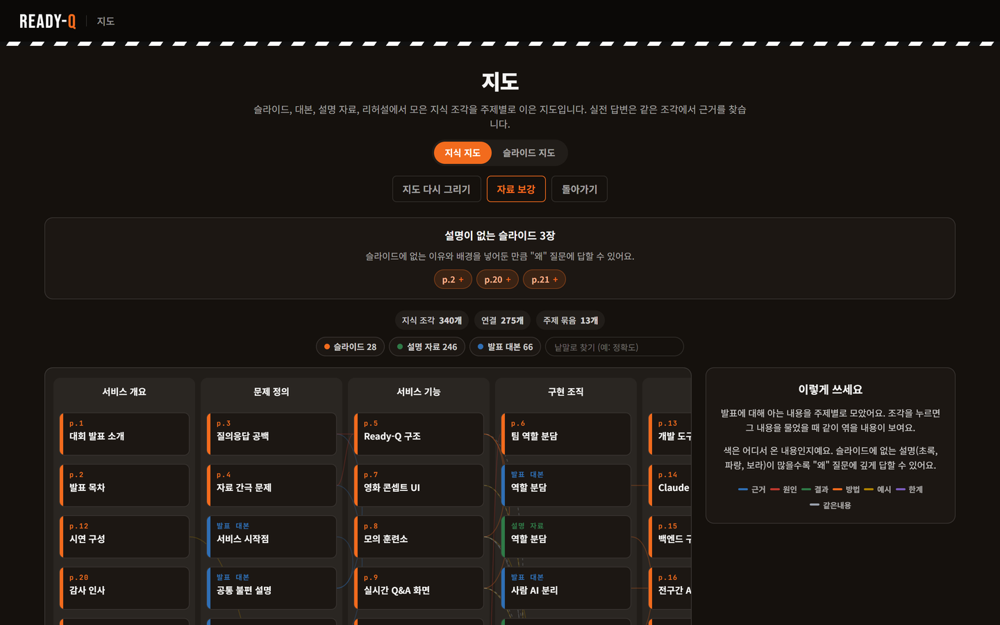
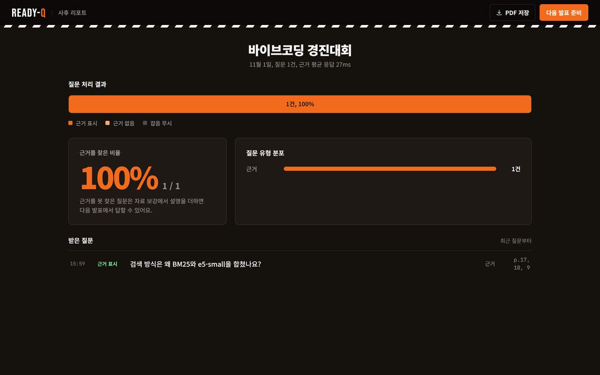
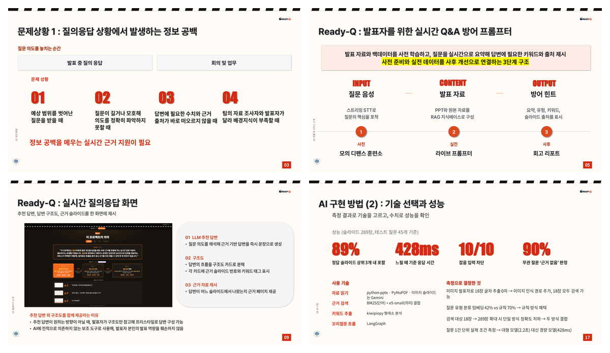
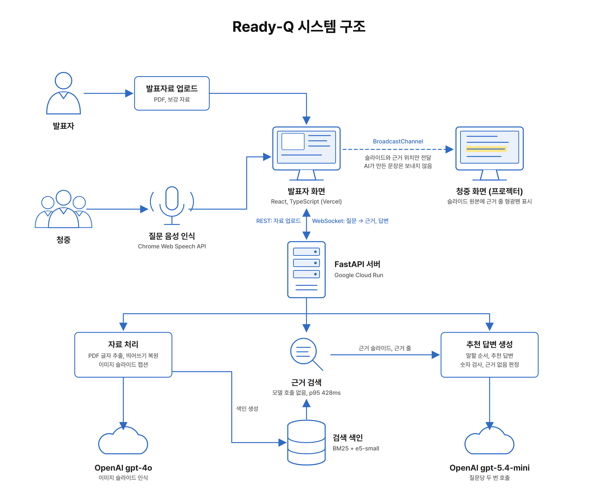

<div align="center">

# Ready-Q

**발표 질의응답 프롬프터**

청중 질문을 듣고 근거 슬라이드, 말할 순서, 추천 답변을 발표자 화면에 띄워주는 서비스.

🏆 26-2 명지대학교 AI(클로드 코드) 기반 VIBE CODING 실전활용 경진대회 **우수상**

[🔗 데모 바로가기](https://vibebyebug-vibebyebug.vercel.app) | [📄 발표자료 (PDF)](docs/presentation.pdf) | [📊 AI 측정 기록](ai/README.md)



     
    

## 📌 프로젝트 개요

| 항목 | 내용 |
|---|---|
| 기간 | 2026.09.03 ~ 2026.10.04 |
| 인원 | 4명 (PM 1, 백엔드 1, 프론트엔드 1, AI 1) |
| 수상 | 26-2 명지대 VIBE CODING 실전활용 경진대회 우수상 |
| 배포 | 화면 Vercel, 백엔드 Google Cloud Run |

발표는 준비해도 질의응답은 준비하기 어렵다. 질문을 받는 순간, 어느 슬라이드에 근거가 있었는지 떠올리지 못하면 제대로 답을 하기 어렵다.
Ready-Q는 이러한 상황에서 도움을 주기 위해, 발표자료를 미리 읽어두었다가 질문이 들어오면 **1초 안에** 근거와 답변 순서를 보여주는 서비스이다.

<br>

## ✨ 주요 기능

| 구간 | 기능 | 설명 |
|---|---|---|
| 발표 전 | 예상 질문 생성 | 자료를 읽고 나올 만한 질문을 유형별로 만든다 |
| 발표 전 | 모의 디펜스 | 답변을 말하면 빠뜨린 근거와 꼬리질문을 알려준다 |
| 발표 중 | 실시간 근거 표시 | 질문을 듣고 근거 슬라이드와 키워드를 428ms(p95) 안에 띄운다 |
| 발표 중 | 추천 답변 | 말할 순서와 추천 답변을 1.4초에 띄운다 |
| 발표 후 | 회고 리포트 | 받은 질문과 판정 결과로 약한 부분을 정리한다 |


### 화면 구성

| 발표 중 화면 | 모의 연습 |
|:---:|:---:|
|  |  |
| 질문을 받으면 추천 답변과 말할 순서, 근거 슬라이드를 띄운다 | 예상 질문에 답하면 빠뜨린 근거를 판정한다 |
| **지식 지도** | **사후 리포트** |
|  |  |
| 슬라이드, 대본, 설명 자료를 주제별로 묶어 보여준다 | 받은 질문과 근거 표시 비율, 질문 유형을 정리한다 |

### 발표자료

[](docs/presentation.pdf)

[전체 보기 (PDF, 21장)](docs/presentation.pdf). 

<br>

## 🏗 시스템 구조

<p align="center"></p>

- 실시간으로 근거를 찾는 구간은 외부 모델을 부르지 않고, 임베딩도 서버에서 직접 돌린다.
- 모델 호출은 추천 답변과 말할 순서를 만들 때 질문당 두 번이다.

### 기술 스택

| 구분 | 사용 기술 |
|---|---|
| Frontend | React, TypeScript, Vite, Tailwind CSS |
| Backend | Python, FastAPI, Uvicorn, WebSocket |
| 검색 | BM25 + multilingual-e5-small 하이브리드, kiwipiepy |
| 답변 생성 | OpenAI gpt-5.4-mini, 이미지 슬라이드 인식 gpt-4o |
| 음성 인식 | 브라우저 Web Speech API (Chrome) |
| 배포 | Vercel, Google Cloud Run |

<br>

## 👥 팀원 및 역할

|  |  |  |  |
|:---:|:---:|:---:|:---:|
| [조은비](https://github.com/gorani0) | [민서정](https://github.com/VI-II-V) | [박서연](https://github.com/seoye8n) | [이예진](https://github.com/Yejineeeee) |
| PM, QA | 백엔드 | 프론트엔드 | AI |

<details>
<summary><b>담당 업무 자세히 보기</b></summary>

**조은비 (PM, QA)**
- 프로젝트 일정과 역할 분담, 저장소 관리와 PR 머지
- 백엔드와 AI 모듈 연결 (업로드 시 색인 생성, 준비 상태 API, WebSocket에 근거 검색 연결)
- 통합 테스트 작성, 손상된 파일을 올리면 서버가 멈추던 버그 수정
- 백엔드와 AI 통합 단계의 2차 QA 기록 작성
- 라이트 모드, 파일 끌어다 놓기, 브라우저 뒤로 가기로 화면 이동 구현

**민서정 (백엔드)**
- FastAPI 백엔드 파이프라인과 라우터 구축
- PDF 업로드와 파일 검증, 발표자료 목록 조회와 삭제 API 구현
- 회고 리포트용 질의응답 기록 저장과 조회 API 구현
- 음성 인식이 끊길 때를 대비한 텍스트 입력 전환 API, 구간별 지연 시간 계측
- 자료 보관함, 청중 화면 자동 재연결, 마이크 점검 도구 구현
- 폰트가 깨진 PDF를 정상으로 판정하던 문제, 콘솔 인코딩 때문에 서버가 요청을 떨어뜨리던 문제 수정

**박서연 (프론트엔드)**
- 로우파이 프로토타입과 Figma 화면 디자인 제작
- Vite, React, TypeScript 프로젝트 구성과 WebSocket 연결 훅 구현
- 발표 중 화면(HUD)을 포함한 전체 화면 17개 구현
- 공통 헤더와 발표 후 화면의 탭 이동 구현
- Figma 디자인 기준으로 화면 배치 정리, 기본 글꼴(Noto Sans KR) 지정

**이예진 (AI)**
- 검색기 비교 실험 설계와 선택 (6종 비교, 문서 289장, 질문 45개)
- 실시간 근거 검색 경로(`pipeline.py`)와 추천 답변 생성(`answer.py`) 구현
- 근거 없음 판정과 숫자 검사로 지어낸 답변 차단
- 모의 디펜스, 꼬리질문, 회고 리포트 모듈 구현
- 백엔드 Cloud Run 배포와 Vercel 화면 연결

</details>

<br>

## 📊 측정 결과

자세한 기록은 [ai/README.md](ai/README.md) 에 있다.

**검색기 비교** (문서 289장, 손으로 쓴 질문 45개, 질문을 하나씩 넣어 측정)

| 검색기 | R@3 | p50 | p95 | 색인 |
|---|---|---|---|---|
| BM25 + BGE-M3 | 93.3% | 584ms | 2,215ms | 721초 |
| **BM25 + e5-small (채택)** | **88.9%** | **169ms** | **428ms** | **62초** |
| BGE-M3 단독 | 84.4% | 421ms | 608ms | 515초 |
| BM25 단독 | 80.0% | 0.7ms | 1.2ms | 0초 |
| e5-small 단독 | 75.6% | 93ms | 206ms | 122초 |

**그 외**
- 질문 유형 분류: 키워드 규칙 93.3% (임베딩 42.2%, 최다 유형 찍기 46.7%)
- 근거 없음 판정: 관련 질문 100% 통과, 무관한 질문 90% 차단, 잡음 10/10 차단
- 보강 자료 효과: 설명 자료에만 답이 있는 질문의 정답률 0% → 64%

<br>

## 🔥 트러블슈팅

<details>
<summary><b>1. 응답 시간이 실제보다 짧게 측정되던 문제</b></summary>

- **문제**: 처음에는 질문 45개를 한꺼번에 넣고, 걸린 시간을 45로 나누는 방식으로 측정했다. 이렇게 하면 질문당 378ms가 나왔다. 하지만 실제 발표에서는 질문이 하나씩 들어오기 때문에, 이 방식은 실제보다 빠르게 측정될 수밖에 없었다.
- **해결**: 질문을 하나씩 넣는 방식으로 다시 측정했고, 실제 값은 595ms였다. 이후 측정 스크립트가 중앙값(p50)과 함께 느린 경우(p95)까지 보여주도록 수정했다.
- **결과**: 느린 경우 2.2초가 걸리는 BGE-M3 조합은 실시간 검색에서 제외하고, BM25와 e5-small 조합으로 바꾸었다.

</details>

<details>
<summary><b>2. 결과를 두 번에 나눠 보여주니 화면이 흔들리던 문제</b></summary>

- **문제**: 처음에는 빠른 검색 결과를 3ms 만에 먼저 띄우고, 428ms 뒤에 정확한 결과로 바꾸는 방식으로 설계했다. 그런데 직접 측정해보니 질문 8개 중 4개에서 첫 번째 카드가 바뀌었다. 게다가 카드가 바뀌는 시점이 발표자가 화면으로 눈을 옮기는 시점과 겹쳐서, 발표자에게는 화면이 흔들리는 것으로만 보였다.
- **해결**: 결과를 두 번에 나누지 않고, 정확한 결과를 한 번에 보여주도록 바꾸었다. 428ms 정도의 대기는 사람이 느리다고 느끼는 1초보다 충분히 짧았다.
- **결과**: 화면이 안정되었고, 백엔드와 주고받는 API도 `rq.cue(question)` 하나로 단순해졌다.

</details>

<details>
<summary><b>3. PowerPoint에서 저장한 PDF의 띄어쓰기가 사라지던 문제</b></summary>

- **문제**: PowerPoint로 저장한 PDF를 올리면 근거 문장이 "구독500 명으로운영BEP,"처럼 띄어쓰기 없이 나왔다. 글자 위치를 확인해봐도 단어 사이 간격이 0이어서, 위치 정보만으로는 띄어쓰기를 되살릴 수 없었다.
- **해결**: 한글 사이의 공백 비율을 보고 이런 자료를 먼저 골라낸 뒤, 형태소 분석기(kiwipiepy)로 띄어쓰기를 다시 넣었다. 이 과정에서 사람 이름이나 외래어가 "민 서정", "미들 웨어"처럼 잘못 쪼개지는 문제가 생겼는데, PDF 안의 글자 묶음 경계를 함께 참고해서 바로잡았다.
- **결과**: 정답 문장을 첫 번째 근거로 보여준 문항이 18개 중 5개에서 9개로 늘었다.

</details>

<details>
<summary><b>4. 가장 흔한 질문이 "근거 없음"으로 막히던 문제</b></summary>

- **문제**: "이 프로젝트를 왜 만드셨나요?", "한계는 무엇인가요?", "장점은요?" 같은 질문이 모두 근거 없음으로 처리되었다. 질문에 나온 단어가 자료에 얼마나 있는지로 판정했는데, 발표자료에는 "프로젝트", "한계" 같은 단어가 한 번도 나오지 않았기 때문이다. 발표장에서 가장 자주 나오는 질문을 막고 있던 셈이다.
- **해결**: 이런 단어는 판정 계산에서 빼고, 자료에서 쓰일 만한 표현으로 바꿔서 찾도록 했다. 예를 들어 "한계"는 "다만", "향후", "과제"로 바꿔 찾는다.
- **결과**: 흔한 질문에도 답이 나오게 되었고, 기존 판정 성능(관련 질문 100% 통과, 무관한 질문 90% 차단)도 그대로 유지했다.

</details>

<details>
<summary><b>5. 숫자 검사가 모델 이름까지 막던 문제</b></summary>

- **문제**: 추천 답변에 나온 숫자가 자료에 있는지 확인하는 검사가 있는데, 이 검사가 `BM25`의 25나 `e5-small`의 5까지 수치로 인식했다. 그래서 질문에 나온 모델 이름을 답변에서 다시 언급하기만 해도 답변 전체가 사라졌다.
- **해결**: 글자에 붙어 있는 숫자는 하나의 이름으로 보고, 그 이름이 자료나 질문에 나와 있으면 통과시키도록 바꾸었다.
- **결과**: 검사 13건 중 잘못 막히던 4건이 통과하게 되었고, 나머지 9건은 판정이 그대로였다.

</details>

<br>

## 📂 폴더 구조

```
vibebyebug
├── src/            # 프론트엔드 (React)
│   ├── components/ # 화면 단위 컴포넌트
│   └── hooks/      # 음성 인식, WebSocket, 마이크 입력
├── routers/        # FastAPI 라우터 (업로드, 검색, 연습, 기록)
├── ai/             # AI 모듈 (검색, 답변 생성, 모의 디펜스, 평가 스크립트)
├── docs/           # 시연 GIF, 발표자료
├── main.py         # 백엔드 진입점
└── Dockerfile      # Cloud Run 배포
```

<br>

## 🚀 실행 방법

```bash
# 백엔드
pip install -r requirements.txt
python -m uvicorn main:app --port 8000

# 프론트엔드 (다른 터미널)
npm install
npm run dev
```

`ai/.env` 에 API 키를 넣어야 추천 답변과 예상 질문이 만들어진다. (키가 없어도 글자가 있는 PDF의 업로드와 근거 검색까지는 동작한다.)
설치가 막히면 [SETUP.md](SETUP.md), 배포 절차는 [DEPLOY_CLOUDRUN.md](DEPLOY_CLOUDRUN.md) 참고.
